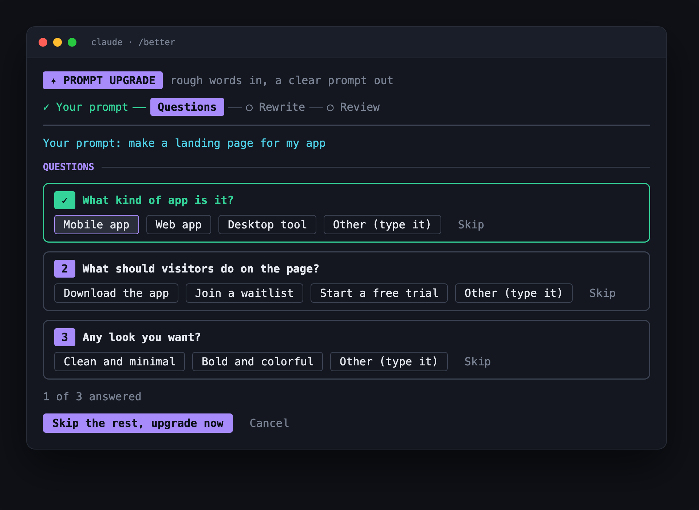
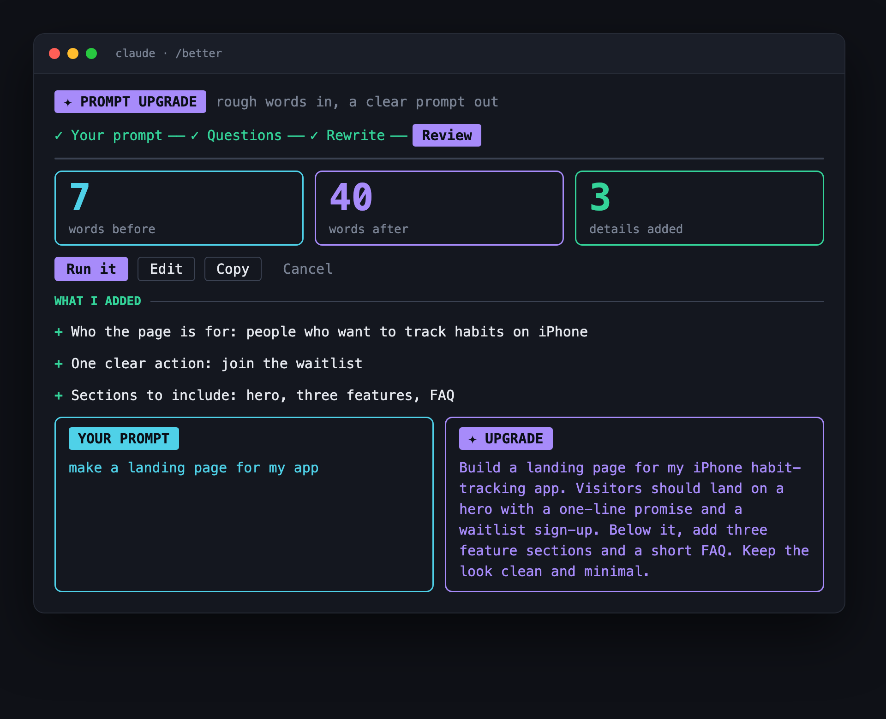
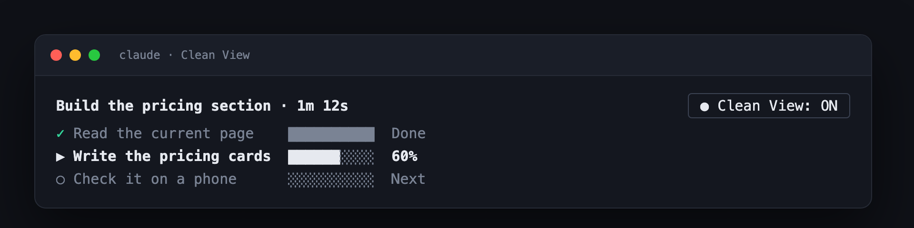

# claude-mods

Two small mods for [Claude Code](https://claude.com/claude-code) that make it calmer and easier to use, especially if you are not a developer.

| Mod | What it does | Command |
| --- | --- | --- |
| [**prompt-upgrade**](#prompt-upgrade) | Turns a rough prompt into a clear one in a review pane, before anything is sent | `/better` |
| [**clean-view**](#clean-view) | Replaces the stream of tool rows with a plain checklist above the prompt | `/simple` |

## Install

Install what you want, straight from this repository:

```
/plugin install prompt-upgrade --marketplace Hardikkhanesa/claude-mods
/plugin install clean-view --marketplace Hardikkhanesa/claude-mods
```

Run `/reload-plugins` if the commands do not show up right away.

To install from a local clone instead:

```
claude plugin marketplace add ./claude-mods
/plugin install prompt-upgrade --marketplace hardik-mods
```

---

## prompt-upgrade

Type a rough idea, and get back a prompt Claude can do a good job with. Nothing is sent until you press **Run it**.



### How it works

1. **Your prompt**: type `/better make a landing page for my app`, or just `/better` to get an input box.
2. **Questions**: Claude asks up to three short multiple-choice questions about what is missing. Pick an option, type your own, or skip.
3. **Rewrite**: your words and answers are turned into one clear prompt.
4. **Review**: see what changed, edit it if you like, then run it or copy it.



The review step shows word counts before and after, a list of every detail that was added, and your prompt next to the upgrade.

### Commands

| Command | What it does |
| --- | --- |
| `/better <rough prompt>` | Start an upgrade with your words |
| `/better` | Open the pane with an empty input box |
| `/better on` / `/better off` | Automatic mode: every prompt you type goes to the pane first |
| `/better history` | Your last 20 upgrades, each one reopens for review |

### Good to know

- **Your words are safe.** Cancel puts your original prompt back in the box. If the model call fails, you can try again or send your original as is.
- **It is cheap.** The questions and the rewrite use the small, fast model (Haiku).
- **It needs room.** The pane needs a reasonably wide terminal. If the window is too narrow, your words go back to the prompt box with a short message.
- **Your colors.** Text follows your terminal theme. The accents are violet for the upgrade, cyan for your words, green for done and added, and rose for errors.

---

## clean-view

A plain checklist above the prompt, with the tool rows hidden. Made for people who want to see how far along Claude is without reading file names and commands.



- A short title and a timer for the current job.
- One row per step, each with a progress bar: done, working (with a percentage when known), or next.
- A clear **Needs you** badge when Claude is waiting for an answer or a permission.
- Plain-language messages when something goes wrong, such as "the internet connection dropped" or "type /compact and try again".
- Code, file paths and file names are left out of the step names.

### Commands

| Command | What it does |
| --- | --- |
| `/simple on` / `/simple off` | Switch Clean View on or off |

You can also click the **Clean View** button at the right edge of the band.

---

## About the screenshots

The images in `docs/` are rendered previews that use the mods' real layout and colors, not captures of a live terminal. Your terminal's font, theme and width will make it look a little different.

## Development

Each mod is a plain folder with `.claude-plugin/plugin.json`, `hooks/` and a `types/` contract. To work on one:

```
claude plugin validate ./prompt-upgrade
claude plugin test ./prompt-upgrade
```

The preview pages are in `docs/preview/`. Open one in a browser and take a screenshot to refresh an image.
